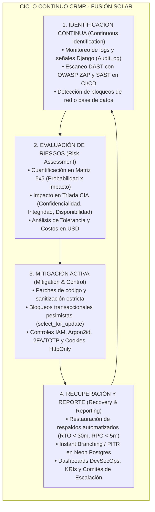
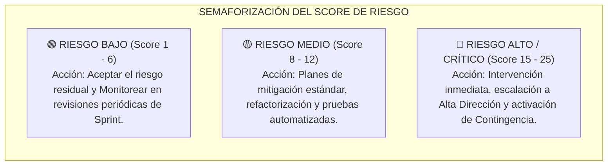
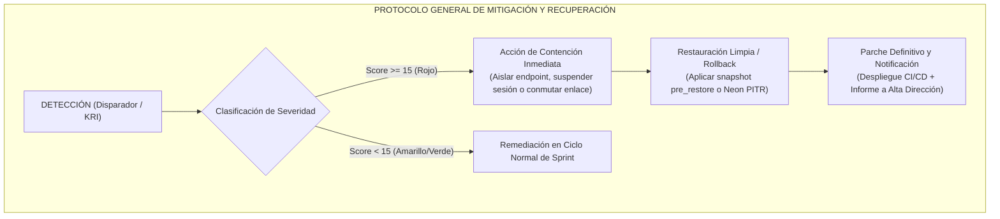
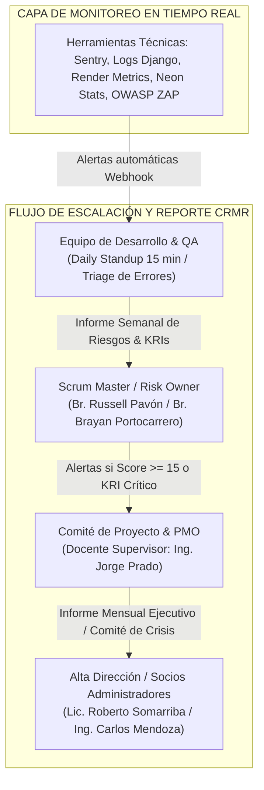
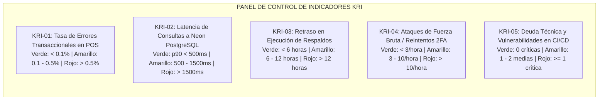

# PLAN DE GESTIÓN CONTINUA Y MITIGACIÓN DE RIESGOS (CRMR)
## Metodología Continuous Risk Management and Recovery aplicada al Sistema ERP Fusión Solar

**Institución:** Universidad Nacional de Ingeniería (UNI) · Área de TIC · Ingeniería de Software III  
**Entidad Auditada:** Fusión Solar — Managua, Nicaragua (Sector Energía Solar Fotovoltaica)  
**Plataforma:** Sistema Fullstack ERP / POS e Inventario (`FS-CrudDjango-React`)  
**Arquitectura:** React 18 SPA (Vercel Edge) + Django 5.0.12 REST Framework (Render PaaS) + Neon Serverless PostgreSQL 15+ (TLS 1.3 / PgBouncer)  
**Equipo Auditor / Autores:**  
- Br. Russell Ali Pavón Solís (2020-0333U) — Auditor Líder / DevSecOps  
- Br. Brayan Josué Portocarrero Vega (2022-0428U) — Auditor de Seguridad y QA  
**Docente Supervisor:** Ing. Jorge Prado  
**Contraparte Empresarial (Alta Dirección):**  
- Lic. Roberto Somarriba — Socio Administrador 1 (Operaciones y Finanzas)  
- Ing. Carlos Mendoza — Socio Administrador 2 (Ventas y Gestión Técnica)  
**Fecha de Emisión / Aprobación:** Noviembre de 2026  
**Versión del Plan:** 1.0 (Producción / Post-Auditoría SQA)  

---

## 1. Contexto, Alcance y Objetivos de Resiliencia

### 1.1 Contexto Organizacional y Tecnológico
Fusión Solar es una empresa con sede comercial en Altamira, Managua, dedicada a la ingeniería, distribución e instalación de sistemas solares fotovoltaicos residenciales y corporativos (paneles monocristalinos, inversores cargadores, bancos de baterías de litio/gel, controladores MPPT y material eléctrico de alta tensión). Las cotizaciones y ventas promedio oscilan entre \$1,200 y \$4,500 USD por transacción, haciendo que cualquier interrupción transaccional o corrupción del balance de stock impacte directamente en el flujo de caja y la credibilidad corporativa.

El sistema informático centraliza:
1. **Control de Acceso Lógico e Identidades (IAM):** Gestión de roles (Administradores, Vendedores, Bodegueros), autenticación robusta con hash Argon2id, autenticación de dos factores (2FA/TOTP conforme a RFC 6238) y sesiones protegidas vía cookies `HttpOnly`, `Secure` y `SameSite=Strict`.
2. **Punto de Venta (POS) y Facturación:** Emisión de recibos de caja, cotizaciones formales en PDF, validación de carritos y cálculo exacto de impuestos y descuentos.
3. **Gestión de Existencias e Inventario:** Movimientos multialmacén, control de despachos y prevención de sobreventa mediante bloqueos transaccionales pesimistas (`select_for_update()`).
4. **Compras y Proveedores:** Registro de recepciones de suministros internacionales e importaciones solares, fiscalización de números de factura únicos.
5. **Directorio de Clientes y Cumplimiento Legal:** Gestión de datos personales y tributarios (cédula de identidad, número RUC, coordenadas y domicilios de fincas o residencias para instalaciones solares) bajo los alcances de la **Ley 787 de Protección de Datos Personales de la República de Nicaragua**.
6. **Continuidad Operativa y Respaldo:** Módulo desacoplado de copias de seguridad calientes (`backup_service.py`), snapshots preventivos antes de restauración (`pre_restore`), retención automatizada y branching en la nube de Neon.

### 1.2 Alcance del Plan
El presente plan abarca la totalidad de los componentes de hardware, software, bases de datos, redes perimetrales, procesos operativos y personal vinculados a la plataforma:
- **Capa Cliente (Frontend):** Repositorio `fs-front` (React 18, Vite, Axios, DOMPurify, desplegado en Vercel Edge).
- **Capa Servidor (Backend API):** Aplicación `django_crud` y módulo `fs` (Python 3.12, Django 5.0.12, Django REST Framework, Gunicorn, desplegado en contenedor Docker no privilegiado en Render).
- **Capa de Persistencia:** Clúster serverless PostgreSQL 15+ en Neon (Compute autosuspendible, pooler PgBouncer, storage redundante multizona, conexiones TLS 1.3 obligatorias).
- **Capa Local / Sucursal:** Terminales de mostrador en Punto de Venta Altamira, enlaces de conectividad por fibra óptica y redes de contingencia celular LTE.

### 1.3 Objetivos de Resiliencia del Negocio
En concordancia con los supuestos de la metodología CRMR y los acuerdos con los socios administradores:
- **RTO Objetivo (Recovery Time Objective):** Menor a **30 minutos** para restauración de servicios críticos en caídas mayores; menor a **5 minutos** para rollback en fallos de despliegue.
- **RPO Objetivo (Recovery Point Objective):** Menor a **5 minutos** de pérdida de datos transaccionales de ventas gracias a la sincronización en Neon y los respaldos lógicos diferenciales/incrementales.
- **Tolerancia a Indisponibilidad Financiera:** Máximo admisible de **4 horas continuas** en días hábiles (evitando superar el umbral de pérdida de \$2,000 USD estimado en ventas y cotizaciones).
- **Disponibilidad de Servicio (SLA Target):** **99.9%** mensual en el backend y frontend en la nube.

---

## 2. Marco Metodológico CRMR (Continuous Risk Management and Recovery)

La metodología **CRMR** (Gestión Continua de Riesgos y Recuperación) sustituye las evaluaciones tradicionales estáticas (las cuales solo reflejan una fotografía momentánea del sistema) por un **modelo dinámico y adaptativo de ciclo cerrado en cuatro etapas continuas**, asegurando la detección oportuna de amenazas, la neutralización de vulnerabilidades y la restauración inmediata de la operatividad del negocio:



### Supuestos Previos de Aplicación Cumplidos:
1. **Inventario de Activos Actualizado:** Catálogo formal de endpoints REST, modelos de base de datos relacionales, contenedores Docker, dominios DNS y hardware de POS Altamira.
2. **Compromiso de la Alta Dirección:** Aprobación explícita de los socios administradores (Lic. Somarriba e Ing. Mendoza) para invertir en infraestructura cloud de alta disponibilidad (Render, Vercel, Neon) y respaldos continuos.
3. **Infraestructura de Monitoreo:** Registro inmutable mediante tabla `AuditLog` en base de datos, señales automáticas de Django (`fs/signals.py`), middleware de usuario (`CurrentUserMiddleware`) y métricas de salud en runtime.
4. **Políticas Claras de Tolerancia al Riesgo:** Criterios estandarizados de riesgo residual aceptable frente al riesgo financiero del inventario solar.

---

## 3. Matriz de Criterios de Evaluación Cuantitativa (5 × 5)

Para eliminar la ambigüedad en la clasificación de incidentes y vulnerabilidades, se adoptan las escalas normalizadas de la metodología CRMR, combinando la probabilidad de ocurrencia técnica con el impacto financiero y operativo específico de Fusión Solar:

### 3.1 Escala de Probabilidad de Ocurrencia (P)

| Nivel | Clasificación | Frecuencia Estimada / Probabilidad | Criterio Técnico y Operativo |
| :---: | :--- | :---: | :--- |
| **1** | **Muy Baja / Raro** | < 10% | Amenaza teórica; requiere condiciones simultáneas altamente improbables o acceso físico privilegiado. |
| **2** | **Baja / Poco Probable** | 10% – 30% | Podría ocurrir esporádicamente si fallan controles secundarios; requiere vector de ataque sofisticado. |
| **3** | **Moderada / Posible** | 30% – 50% | Ha ocurrido en el pasado o existen antecedentes en sistemas similares; error humano o fallo transaccional concurrente. |
| **4** | **Alta / Probable** | 50% – 80% | Frecuente si no existen controles automatizados; interrupción de servicios de red locales o intentos repetitivos de autenticación. |
| **5** | **Muy Alta / Casi Seguro** | > 80% | Vulnerabilidad expuesta permanentemente a Internet; defecto sistemático en el código fuente que se ejecuta en cada transacción. |

### 3.2 Escala de Impacto Operativo y Financiero (I)

| Nivel | Severidad | Impacto en Operaciones / Tiempo | Criterio Financiero en Fusión Solar (USD) | Impacto en la Tríada CIA y Cumplimiento |
| :---: | :--- | :--- | :--- | :--- |
| **1** | **Insignificante** | Retraso < 1 hora / Detalle estético menor en UI | Costo / Pérdida < \$100 USD | Sin afectación a la integridad de datos ni a la confidencialidad. |
| **2** | **Menor** | Retraso 1 – 4 horas / Lógica secundaria lenta (ej. PDF) | Costo extra \$100 – \$500 USD | Afectación leve a disponibilidad de consultas; datos íntegros. |
| **3** | **Moderado** | Retraso 4 – 12 horas / Suspensión temporal de compras | Costo extra \$500 – \$2,000 USD | Inconsistencias temporales reversibles en inventario sin fuga de datos. |
| **4** | **Mayor** | Retraso 12 – 24 horas / Caída total de ventas en POS Altamira | Pérdida \$2,000 – \$10,000 USD | Fuga parcial de metadatos o sobreventa confirmada de paneles solares. |
| **5** | **Crítico** | Retraso > 24 horas / Corrupción irreversible de base de datos | Pérdida > \$10,000 USD | Brecha masiva de datos Ley 787, secuestro de datos o destrucción de balances contables. |

### 3.3 Cálculo del Nivel de Riesgo Global (Score)
$$\text{Score de Riesgo} = \text{Probabilidad } (P) \times \text{Impacto } (I)$$

El valor resultante clasifica el riesgo en tres cuadrantes de atención operativa:



- **🟢 Bajo (1 a 6):** Tolerancia aceptada. Requiere monitoreo preventivo en revisiones quincenales de sprint.
- **🟡 Medio (8 a 12):** Tolerancia condicional. Debe mitigarse en el corto plazo mediante controles activos de código y configuración.
- **🔴 Alto / Crítico (15 a 25):** Inaceptable. Detiene despliegues productivos, exige remediación inmediata (parche en caliente) y notificación urgente a los socios administradores.

---

## 4. Registro y Matriz General de Riesgos del Sistema Fusión Solar

La siguiente matriz consolida los riesgos reales identificados durante la auditoría de seguridad informática y las pruebas SQA sobre el software, evaluando el **Riesgo Inherente** (sin controles) frente al **Riesgo Residual** obtenido tras el despliegue de las medidas de mitigación del modelo CRMR:

| ID | Riesgo Identificado | Causa Raíz / Vector de Ataque | Módulo / Activo Afectado | P | I | Score Inh. | Estrategia | Acción de Mitigación CRMR (Preventiva / Correctiva) | Responsable Técnico | PR | IR | Score Resid. | Estado CRMR |
| :---: | :--- | :--- | :--- | :---: | :---: | :---: | :---: | :--- | :--- | :---: | :---: | :---: | :---: |
| **R-01** | **Acceso anónimo no autorizado a catálogo y bodegas** (`DEF-002`) | Endpoints REST sin validación de permisos por defecto en DRF. | `fs/api/views/crud_views.py` (`/product/`, `/warehouse/`) | 5 | 4 | **20 (Crítico)** | **Mitigar** | Configuración obligatoria de `DEFAULT_PERMISSION_CLASSES = [IsAuthenticated]` en `settings.py` y refuerzo en cada ViewSet. | DevSecOps Lead / Backend | 1 | 2 | **2 (Bajo)** | **Mitigado y Auditado** |
| **R-02** | **Escalamiento de privilegios en gestión de usuarios** (`DEF-005`) | Control de acceso delegado al frontend; endpoints de usuarios permitían a roles bajos crear administradores (IDOR/BOLA). | `fs/api/views/auth_views.py` (`userViewSet`) | 4 | 5 | **20 (Crítico)** | **Mitigar** | Restricción estricta con `IsAdminUser` para gestión de staff; bloqueo de campos privilegiados (`is_staff`, `is_superuser`) a usuarios estándar. | Auditor SQA / Backend | 1 | 3 | **3 (Bajo)** | **Mitigado y Auditado** |
| **R-03** | **Facturación inconsistente con carritos vacíos o \$0.00** (`DEF-001`) | Serializador de ventas no validaba longitud mínima de la lista de detalles de venta. | `fs/api/serializers/sale_serializers.py` (POS) | 4 | 4 | **16 (Crítico)** | **Mitigar** | Validación rigurosa `allow_empty=False` y verificación de `quantity > 0` con cálculo matemático atómico del total. | Desarrollador Backend | 1 | 2 | **2 (Bajo)** | **Mitigado y Auditado** |
| **R-04** | **Sobreventa de paneles/baterías por concurrencia simultánea** (`HAL-001`) | Condiciones de carrera (*race conditions*) por lecturas sucias en concurrencia sin bloqueo de fila. | `fs/models/inventory.py` y `ProcessSaleView` | 4 | 4 | **16 (Crítico)** | **Mitigar** | Migración a Neon PostgreSQL 15+ e implementación de bloqueos pesimistas `Product.objects.select_for_update()` en transacciones atómicas. | Arquitecto Cloud / DB | 1 | 3 | **3 (Bajo)** | **Mitigado y Auditado** |
| **R-05** | **Duplicidad de órdenes de compra con mismo proveedor** (`DEF-008`) | Falta de restricción de unicidad compuesta ante reintentos de red o doble clic de digitadores. | `fs/models/purchases.py` (Módulo Compras) | 4 | 3 | **12 (Medio)** | **Mitigar** | Restricción `UniqueConstraint(fields=['supplier', 'invoice_number'])` en base de datos y validación previa en serializer. | Desarrollador Backend | 1 | 2 | **2 (Bajo)** | **Mitigado y Auditado** |
| **R-06** | **Compromiso de cuentas por credenciales débiles o fuerza bruta** (`DEF-004`) | Algoritmo obsoleto, aceptación de contraseñas de 1 carácter en reset y reintentos sin bloqueo. | Módulo Auth (`/auth/login/`, `/auth/reset/`) | 4 | 4 | **16 (Crítico)** | **Mitigar** | Migración a hashing **Argon2id**, validadores Django `MinimumLengthValidator(8)`, 2FA/TOTP obligatorio y bloqueo tras 5 intentos fallidos. | DevSecOps Lead | 1 | 2 | **2 (Bajo)** | **Mitigado y Auditado** |
| **R-07** | **Robo de tokens de sesión mediante ataques XSS** | Almacenamiento previo de credenciales/tokens en el `localStorage` del navegador. | `fs-front` (React SPA) | 4 | 5 | **20 (Crítico)** | **Mitigar** | Erradicación total de `localStorage`. Autenticación mediante Cookies seguras `HttpOnly`, `Secure` y `SameSite=Strict` + sanitización con DOMPurify. | Frontend Lead / DevSecOps | 1 | 2 | **2 (Bajo)** | **Mitigado y Auditado** |
| **R-08** | **Pérdida o corrupción catastrófica de base de datos en Neon** | Desastre en región de nube, corrupción lógica por bug o error humano de migración. | Base de datos PostgreSQL (Neon Serverless) | 2 | 5 | **10 (Medio)** | **Transferir / Mitigar** | Respaldo en tres capas: 1) Backups full (`pg_dump -Fc`) + incrementales; 2) Snapshot preventivo obligatorio `pre_restore`; 3) Neon PITR y Branching. | Administrador DB / Cloud | 1 | 4 | **4 (Bajo)** | **Mitigado y Auditado** |
| **R-09** | **Interrupción operativa en POS Altamira por caída de enlace de Internet** | Vulnerabilidad de conectividad física monoproveedor en la sucursal de ventas. | Enlace de Fibra Óptica / Terminal POS Altamira | 4 | 3 | **12 (Medio)** | **Transferir / Contingencia** | Implementación de doble enlace con router de conmutación automática (*failover*) a módem 4G LTE y tolerancia de cache local en proformas. | Jefe de Infraestructura / Soporte | 2 | 2 | **4 (Bajo)** | **En Monitoreo** |
| **R-10** | **Fuga de datos personales de clientes (Infracción Ley 787)** | Ausencia de cláusula explícita de consentimiento y falta de cifrado en tránsito. | `fs/models/customers.py` (Base de Clientes) | 3 | 4 | **12 (Medio)** | **Mitigar** | Conexiones cifradas TLS 1.3 (`sslmode=require`), política de privacidad redactada, consentimiento en UI y registros en `AuditLog`. | Asesor Legal / DevSecOps | 1 | 2 | **2 (Bajo)** | **Mitigado y Auditado** |
| **R-11** | **Path Traversal en descarga y manipulación de backups** (`DEF-006`) | Parámetro `filename` en endpoint de descargas manipulable mediante cadenas relativas (`../`). | `fs/api/views/backup_views.py` | 3 | 4 | **12 (Medio)** | **Mitigar** | Validación con `os.path.basename` y resolución canónica estricta dentro del directorio seguro `backups/`. | Backend Lead | 1 | 2 | **2 (Bajo)** | **Mitigado y Auditado** |
| **R-12** | **Inyección de peticiones maliciosas (CSRF)** | Ausencia de sincronización entre tokens CSRF y cookies de petición asíncronas en Axios. | Comunicación API REST - SPA React | 3 | 4 | **12 (Medio)** | **Mitigar** | Interceptor centralizado en Axios para extraer e inyectar cabecera `X-CSRFToken` sincronizada con cookie `csrftoken`. | Frontend Lead | 1 | 2 | **2 (Bajo)** | **Mitigado y Auditado** |

---

## 5. Planes de Contingencia y Mitigación Detallados (Fichas Técnicas CRMR)

A continuación, se presentan las **Fichas Técnicas de Acción CRMR** para los riesgos de mayor criticidad del sistema, especificando los mecanismos preventivos de código, las acciones correctivas de contingencia (DRP) y los tiempos objetivos de recuperación:



---

### FICHA TÉCNICA R-01: Exposición de Endpoints y Acceso Anónimo a la API
- **ID de Riesgo:** `R-01` (Auditoría: `DEF-002`)
- **Activo Crítico:** Módulos de Productos, Categorías y Bodegas (`/fs/apibd/v1/product/`).
- **Disparador de Activación (Trigger):** Petición `GET /fs/apibd/v1/product/` recibida sin cabecera de autorización ni cookie válida que responda con código `HTTP 200 OK` en el escáner dinámico o en logs de producción.
- **Acciones Preventivas (Mitigación en Código):**
  1. Configuración global en `django_crud/settings.py` cerrando por diseño cualquier vista que no especifique lo contrario:
     ```python
     REST_FRAMEWORK = {
         'DEFAULT_AUTHENTICATION_CLASSES': (
             'fs.api.authentication.CookieTokenAuthentication',
             'rest_framework.authentication.TokenAuthentication',
         ),
         'DEFAULT_PERMISSION_CLASSES': (
             'rest_framework.permissions.IsAuthenticated',
         ),
     }
     ```
  2. Adición explícita de `permission_classes = [IsAuthenticated]` en todos los ViewSets de negocio en `fs/api/views/crud_views.py`.
- **Plan de Contingencia / Recuperación (Acción Correctiva):**
  1. Si un endpoint resulta expuesto en producción tras una actualización, el API Gateway / Nginx inyecta una regla de bloqueo inmediato (`HTTP 401 Unauthorized`) sobre la ruta comprometida.
  2. Ejecución del hotfix en la rama de despliegue y push al pipeline de Render.
  3. Auditoría forense en `AuditLog` para validar si hubo extracción masiva de datos durante la ventana de exposición.
- **Tiempos de Resiliencia:** **RTO < 10 minutos** | **RPO = 0 minutos** (No implica alteración de datos).

---

### FICHA TÉCNICA R-02: Escalamiento de Privilegios en Gestión de Usuarios (IDOR/BOLA)
- **ID de Riesgo:** `R-02` (Auditoría: `DEF-005`)
- **Activo Crítico:** Módulo de Gestión de Identidades y Cuentas (`userViewSet`).
- **Disparador de Activación (Trigger):** Intento de creación, edición o eliminación de un usuario por parte de una cuenta con rol no administrador (`is_staff=False`), o intento de manipulación de los campos `is_superuser` o `is_staff`.
- **Acciones Preventivas (Mitigación en Código):**
  1. Blindaje del `userViewSet` en `fs/api/views/auth_views.py`:
     ```python
     class UserViewSet(viewsets.ModelViewSet):
         queryset = User.objects.all()
         serializer_class = UserSerializer
         permission_classes = [IsAuthenticated]

         def get_permissions(self):
             # Solo superusuarios y staff pueden crear, listar o eliminar otros usuarios
             if self.action in ['create', 'destroy', 'list']:
                 return [IsAdminUser()]
             return [IsAuthenticated()]

         def update(self, request, *args, **kwargs):
             instance = self.get_object()
             # Control Anti-IDOR: un usuario común solo puede modificar su propio registro
             if not request.user.is_staff and instance.pk != request.user.pk:
                 raise PermissionDenied("No tiene permisos para modificar este perfil.")
             return super().update(request, *args, **kwargs)
     ```
  2. Bloqueo en el serializador de campos de privilegios para prevenir inyecciones masivas (*mass assignment*).
- **Plan de Contingencia / Recuperación:**
  1. Revocación inmediata del token y cookie de la cuenta infractora.
  2. Reversión de los cambios en la tabla de usuarios mediante la auditoría de `AuditLog`.
  3. Ejecución del comando de restablecimiento administrativo:
     ```bash
     python manage.py create_admin --force-password
     ```
- **Tiempos de Resiliencia:** **RTO < 15 minutos** | **RPO = 0 minutos**.

---

### FICHA TÉCNICA R-04: Sobreventa y Desincronización de Inventario en Concurrencia
- **ID de Riesgo:** `R-04` (Auditoría: `HAL-001`)
- **Activo Crítico:** Tabla `fs_product`, inventario de paneles solares e inversores en bodega.
- **Disparador de Activación (Trigger):** Notificación de stock negativo en `fs_product`, o excepción de contención de concurrencia registrada en los logs de transacciones del POS.
- **Acciones Preventivas (Mitigación en Código):**
  1. Uso estricto de transacciones atómicas y bloqueos pesimistas a nivel de base de datos en `ProcessSaleView`:
     ```python
     from django.db import transaction

     @transaction.atomic
     def process_sale_transaction(sale_data, user):
         # Bloqueo exclusivo de fila para prevenir lecturas sucias simultáneas
         for item in sale_data['items']:
             product = Product.objects.select_for_update().get(id=item['product_id'])
             if product.stock_quantity < item['quantity']:
                 raise ValidationError(
                     f"Stock insuficiente para '{product.name}'. "
                     f"Disponible: {product.stock_quantity}, Solicitado: {item['quantity']}"
                 )
             product.stock_quantity -= item['quantity']
             product.save(update_fields=['stock_quantity'])
         # Creación de registro de venta y detalles dentro del mismo bloque atómico
     ```
  2. Monitoreo del pool de conexiones en Neon PostgreSQL mediante PgBouncer.
- **Plan de Contingencia / Recuperación:**
  1. Si una venta fallara en mitad del procesamiento, el bloque `@transaction.atomic` ejecuta automáticamente un `ROLLBACK` completo en la base de datos sin alterar el stock.
  2. En caso de inconsistencia física confirmada por recuento en bodega Altamira, se emite un ajuste de inventario respaldado por un registro en `AuditLog` autorizado por el Socio de Operaciones.
- **Tiempos de Resiliencia:** **RTO < 5 minutos** | **RPO = 0 minutos** (Consistencia ACID garantizada).

---

### FICHA TÉCNICA R-06: Robo de Credenciales y Compromiso de Cuentas (2FA / Brute Force)
- **ID de Riesgo:** `R-06` (Auditoría: `DEF-004`)
- **Activo Crítico:** Módulo de Autenticación, tokens de acceso y directrices de contraseñas.
- **Disparador de Activación (Trigger):** Detección de más de 5 intentos fallidos consecutivos de login o validación TOTP en una misma cuenta en menos de 5 minutos, o alerta de contraseña débil.
- **Acciones Preventivas (Mitigación en Código):**
  1. Adopción de **Argon2id** como algoritmo primario en `settings.py`:
     ```python
     PASSWORD_HASHERS = [
         'django.contrib.auth.hashers.Argon2PasswordHasher',
         'django.contrib.auth.hashers.PBKDF2PasswordHasher',
     ]
     ```
  2. Validación estricta de contraseñas en resets (`validate_password` con longitud mínima de 8 caracteres, complejidad numérica y alfanumérica).
  3. Autenticación de Doble Factor (TOTP conforme a RFC 6238) con bloqueo de desafío tras 5 fallos.
- **Plan de Contingencia / Recuperación:**
  1. Bloqueo automático de la cuenta afectada (`is_active = False`) por 30 minutos o hasta verificación por el administrador.
  2. Revocación de todas las sesiones y cookies activas de dicha cuenta.
  3. Envío de alerta al administrador para restablecimiento asistido.
- **Tiempos de Resiliencia:** **RTO < 15 minutos** | **RPO = 0 minutos**.

---

### FICHA TÉCNICA R-08: Corrupción o Pérdida Catastrófica de la Base de Datos en la Nube
- **ID de Riesgo:** `R-08`
- **Activo Crítico:** Clúster de Base de Datos PostgreSQL 15+ en Neon Serverless.
- **Disparador de Activación (Trigger):** Inaccesibilidad total del servicio de base de datos, error de consistencia en consultas transaccionales o corrupción de datos tras una migración errónea.
- **Acciones Preventivas (Estrategia de Respaldo Continuo):**
  1. Tareas programadas automatizadas mediante el comando `backup_db`:
     - **Full Backup (`pg_dump -Fc`):** Generado los domingos a las 00:00 UTC (`full_YYYYMMDD_HHMMSS.dump`).
     - **Diferencial:** Generado diario a las 23:00 UTC (`differential_YYYYMMDD_HHMMSS.sql.gz`).
     - **Incremental:** Generado cada 4 horas en horario laboral (`incremental_YYYYMMDD_HHMMSS.sql.gz`).
  2. Creación obligatoria de snapshot preventivo `pre_restore_YYYYMMDD_HHMMSS.dump` antes de cualquier restauración.
  3. Política de retención activa (`full`: 4 copias, `differential`: 4 copias, `incremental`: 7 copias) con depuración automática de disco.
- **Plan de Contingencia / Recuperación ante Desastres (DRP):**
  - **Opción A (Restauración Local/CLI con Backup Service):**
    ```bash
    # Paso 1: Generar snapshot preventivo del estado actual
    python manage.py backup_db --type=full
    
    # Paso 2: Ejecutar la restauración limpia con pg_restore
    python manage.py restore_backup --filename=full_20261025_225604.dump
    ```
  - **Opción B (Restauración Instantánea en Neon Cloud - PITR / Branching):**
    1. Si el incidente fue causado por una migración fallida en producción, crear una rama secundaria en Neon en milisegundos a partir del segundo previo al incidente (*Point-in-Time Restore*).
    2. Apuntar la variable `DATABASE_URL` en Render hacia el endpoint de la nueva rama restaurada.
    3. Reanudar el tráfico de ventas en menos de 10 minutos.
- **Tiempos de Resiliencia:** **RTO < 30 minutos** | **RPO < 5 minutos**.

---

### FICHA TÉCNICA R-09: Interrupción de Conectividad en Punto de Venta Altamira
- **ID de Riesgo:** `R-09`
- **Activo Crítico:** Terminal de facturación de mostrador y emisión de proformas en Altamira.
- **Disparador de Activación (Trigger):** Pérdida de comunicación con el backend en Render por corte de fibra óptica local que supere 3 minutos continuos.
- **Acciones Preventivas:**
  1. Enrutador de sucursal configurado con doble WAN (Fibra Óptica principal + Módem 4G LTE de contingencia con SIM corporativo).
  2. Frontend React configurado con Service Worker y almacenamiento de plantillas de proformas en caché de la SPA para consulta de precios fuera de línea.
- **Plan de Contingencia / Operación en Modo Degradado:**
  1. Si falla la fibra óptica, el router conmuta automáticamente al enlace 4G celular en menos de 60 segundos.
  2. Si existiera una caída generalizada de telecomunicaciones en la zona, el cajero emite un talonario de recibo manual de contingencia pre-foliado.
  3. Una vez restablecido el enlace, el cajero digita las ventas manuales en el sistema cotejando la correlación de facturación.
- **Tiempos de Resiliencia:** **RTO < 2 minutos** (conmutación 4G) | **RPO = 0 minutos**.

---

## 6. Esquema de Reporte y Monitoreo Continuo (CRMR Reporting & DevSecOps)

Para garantizar la continuidad operativa real del modelo y evitar que el plan se convierta en un documento inerte, se establece el siguiente flujo formal de comunicación, monitoreo y escalación:



### 6.1 Frecuencias y Audiencias de Reporte

| Frecuencia | Mecanismo / Formato | Audiencia | Contenido Principal y Entregables |
| :--- | :--- | :--- | :--- |
| **Continuo / En Tiempo Real** | Webhooks automatizados (Discord / Slack / Correo) | Equipo Técnico y DevSecOps | Alertas de infraestructura (CPU > 80%, errores HTTP 5xx > 1%, fallos en respaldos, ataques de fuerza bruta). |
| **Diario (15 min)** | Daily Standup ágil | Desarrolladores y QA | Identificación de nuevos bloqueos de código, anomalías en transacciones POS y evaluación de deuda técnica. |
| **Semanal (Sprint Review)** | Informe Semanal de Riesgos (Dashboard CRMR) | Risk Owner y Líder de Proyecto | Estado de los indicadores KRI, conteo de vulnerabilidades cerradas vs. nuevas y resultados de pruebas automáticas. |
| **Mensual** | Informe Ejecutivo de Continuidad | Socios Administradores (Dirección) | Tasa de disponibilidad (Uptime), cumplimiento de RTO/RPO, auditoría de respaldos y consumo de recursos en la nube. |
| **Extraordinario (Inmediato)** | Convocatoria a Comité de Crisis | Todos los involucrados | Se activa cuando un riesgo con **Score ≥ 15 (Rojo)** se materializa o supera el umbral de tolerancia aceptada. |

---

## 7. Indicadores Clave de Riesgo (KRIs - Key Risk Indicators)

Los siguientes indicadores cuantitativos permiten anticipar la materialización de fallos antes de que se transformen en pérdidas financieras o interrupciones del negocio:



### 7.1 Detalle Operativo de los KRIs

1. **KRI-01 — Tasa de Errores Transaccionales en POS (`ProcessSaleSerializer`):**
   - *Fórmula:* $\frac{\text{Ventas con error HTTP 4xx/5xx}}{\text{Total de ventas iniciadas}} \times 100$
   - *Umbrales:* 🟢 Verde: $< 0.1\%$ | 🟡 Amarillo: $0.1\% - 0.5\%$ | 🔴 Rojo: $> 0.5\%$
   - *Acción en Rojo:* Revisión inmediata de validaciones y bloqueo transaccional; pausa temporal de ventas en terminal afectada.

2. **KRI-02 — Latencia de Respuesta de la API y Base de Datos (Neon Postgres p90):**
   - *Fórmula:* Percentil 90 del tiempo de respuesta registrado en endpoints transaccionales.
   - *Umbrales:* 🟢 Verde: $< 500\text{ ms}$ | 🟡 Amarillo: $500\text{ ms} - 1,500\text{ ms}$ | 🔴 Rojo: $> 1,500\text{ ms}$
   - *Acción en Rojo:* Verificación de conexiones en PgBouncer, optimización de queries con `select_related` y análisis de índices en PostgreSQL.

3. **KRI-03 — Antigüedad del Último Respaldo Válido:**
   - *Fórmula:* Tiempo transcurrido desde la generación del último archivo `.dump` o `.sql.gz` con estado íntegro comprobado.
   - *Umbrales:* 🟢 Verde: $< 6\text{ horas}$ | 🟡 Amarillo: $6 - 12\text{ horas}$ | 🔴 Rojo: $> 12\text{ horas}$
   - *Acción en Rojo:* Ejecución manual de `python manage.py backup_db --type=full` y verificación del espacio de almacenamiento en Render/S3.

4. **KRI-04 — Tasa de Intentos Fallidos de Autenticación y Desafíos TOTP:**
   - *Fórmula:* Número de peticiones fallidas contra `/auth/login/` y `/auth/2fa/verify/` por hora.
   - *Umbrales:* 🟢 Verde: $< 3\text{ intentos/hora}$ | 🟡 Amarillo: $3 - 10\text{ intentos/hora}$ | 🔴 Rojo: $> 10\text{ intentos/hora}$
   - *Acción en Rojo:* Bloqueo temporal preventivo de IPs sospechosas en el firewall de Render/Cloudflare y notificación al usuario afectado.

5. **KRI-05 — Deuda Técnica de Seguridad en Dependencias:**
   - *Fórmula:* Cantidad de vulnerabilidades conocidas detectadas por `pip-audit` o `npm audit` en el repositorio.
   - *Umbrales:* 🟢 Verde: $0\text{ críticas o altas}$ | 🟡 Amarillo: $1 - 2\text{ medias}$ | 🔴 Rojo: $\ge 1\text{ crítica o alta}$
   - *Acción en Rojo:* Congelamiento de despliegues de nuevas características; sprint enfocado exclusivamente en remediación y actualización de paquetes.

---

## 8. Verificación, Validación y Simulacros Periódicos (DRP Drills)

Para asegurar que los procedimientos de recuperación funcionen con éxito ante un incidente real, se calendarizan las siguientes pruebas obligatorias:

1. **Batería de Pruebas Automatizadas de Seguridad y Regresión:**
   - Ejecución obligatoria de los 52 tests unitarios e integrados antes de cada pase a producción:
     ```bash
     python manage.py test fs.tests --keepdb
     ```
   - La suite valida la imposibilidad de vender carritos vacíos (`ProcessSaleSerializerValidationTest`), el bloqueo pesimista ante concurrencia (`ConcurrencySaleTest`), el ciclo de vida de backups (`BackupLifecycleTest`) y la protección de endpoints sin token (`CriticalEndpointsSmokeTest`).

2. **Simulacro Semestral de Recuperación ante Desastres (DRP Drill):**
   - Simulación de destrucción de entorno de base de datos en ambiente de staging.
   - Medición cronometrada del tiempo total de restauración limpia con `pg_restore` y verificación de integridad contra el último hash de auditoría.
   - **Criterio de Aprobación:** RTO real inferior a 30 minutos y verificación exitosa de 10 ventas históricas seleccionadas al azar.

3. **Auditoría de Inmutabilidad de Registros (`AuditLog`):**
   - Inspección trimestral de los registros generados por señales en `fs/signals.py`, comprobando que no existan huecos de trazabilidad en operaciones de inventario ni modificaciones no autorizadas a los logs.

---

## 9. Firmas de Aprobación y Compromiso Institucional

El presente Plan de Gestión Continua y Mitigación de Riesgos (CRMR) ha sido formulado, revisado y validado en común acuerdo entre el equipo auditor de la Universidad Nacional de Ingeniería y la Alta Dirección de Fusión Solar:

| Rol | Nombre y Cargo | Entidad | Firma y Fecha |
| :--- | :--- | :--- | :--- |
| **Auditor Líder / DevSecOps** | Br. Russell Alí Pavón Solís (2020-0333U) | UNI · Ing. de Software III | *Firma Registrada — Nov 2026* |
| **Auditor de Seguridad y QA** | Br. Brayan Josué Portocarrero Vega (2022-0428U) | UNI · Ing. de Software III | *Firma Registrada — Nov 2026* |
| **Docente Supervisor** | Ing. Jorge Prado | UNI · Área de TIC | *Firma Registrada — Nov 2026* |
| **Socio Administrador 1** | Lic. Roberto Somarriba (Operaciones / Finanzas) | Fusión Solar Managua | *Firma Registrada — Nov 2026* |
| **Socio Administrador 2** | Ing. Carlos Mendoza (Ventas y Sistemas) | Fusión Solar Managua | *Firma Registrada — Nov 2026* |
